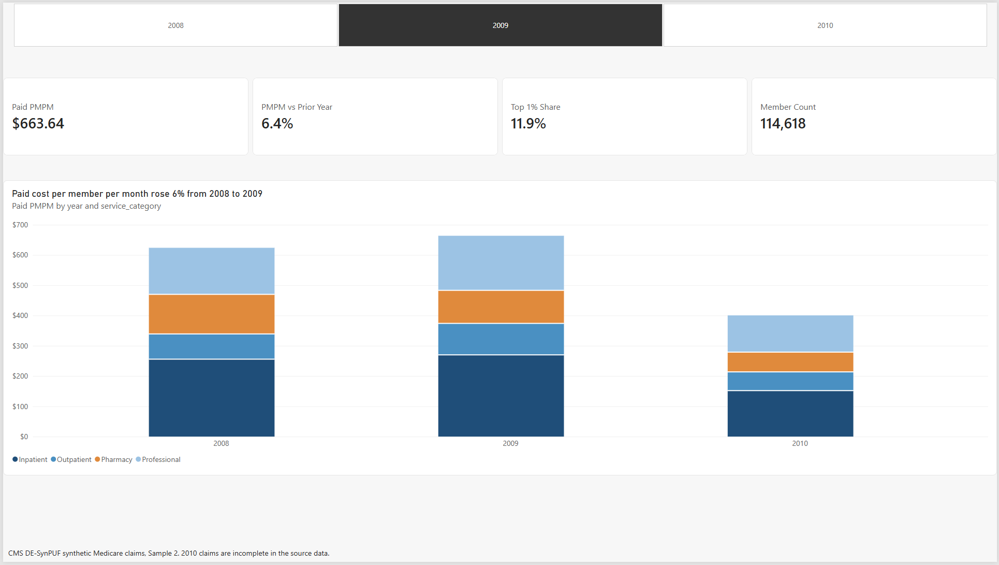
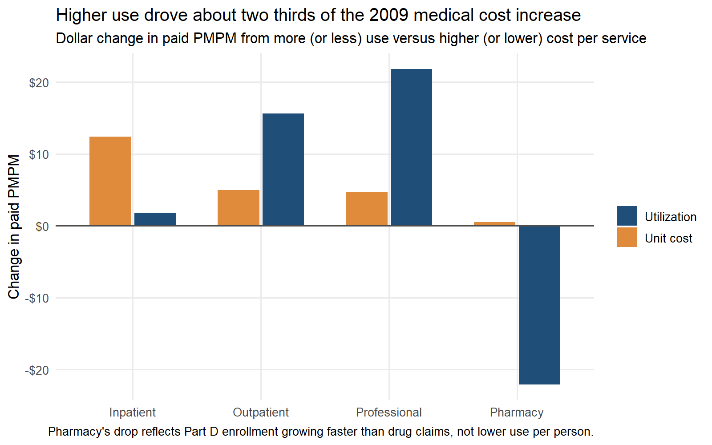
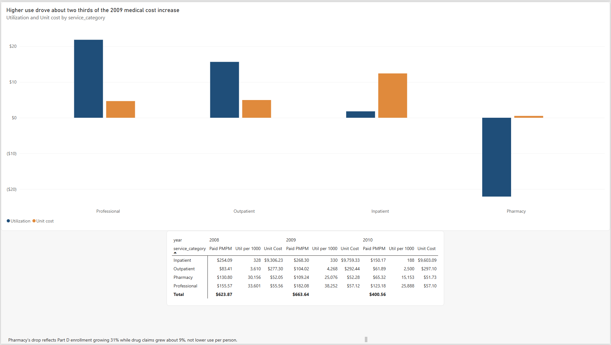
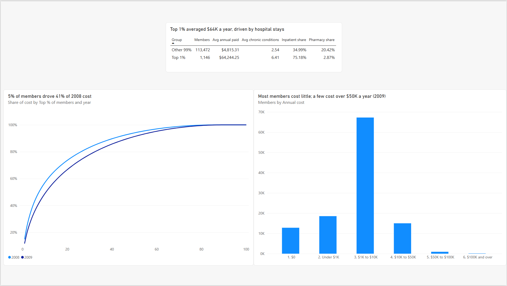

# Medicare Claims Cost and Utilization Trend Analysis

**[Read the one page summary](summary.md)**

A health plan style cost and use analysis of about 11.2 million synthetic Medicare claim and drug event records for about 116,000 members (2008 to 2010). It answers the questions a medical economics or pricing team asks every year: what does each member cost per month, what changed from last year, and was the change driven by people using more care or by care costing more?

**Tools:** SQL (DuckDB, run from R through DBI), R (dplyr, ggplot2), Power BI (DAX), Git



## Key findings

All results are from CMS DE-SynPUF Sample 2. The data is synthetic, so these numbers show the method, not real Medicare results (see Data below).

- **Paid cost per member per month (PMPM) rose 6.4%**, from $623.87 in 2008 to $663.64 in 2009.
- **Higher use drove about two thirds of the medical increase.** Medical PMPM (inpatient, outpatient and professional) rose $61.33, from $493.07 to $554.40. Of that, $39.28 came from members using more care and $22.04 from higher cost per service. Inpatient was the exception: admissions held flat (328 to 330 per 1,000 members) while cost per admission rose 4.9%.
- **Pharmacy PMPM fell 16.5%, but not because people used fewer drugs.** Part D member months grew 31% while drug claims grew about 9%, so the denominator outgrew the claims. Cost per script barely moved (+0.4%).
- **Cost is concentrated.** In 2008 the top 1% of members drove 15% of total cost and the top 5% drove 41%. In 2009 the top 1% (1,146 members) averaged $64,244 a year versus $4,815 for everyone else, had 6.4 chronic conditions versus 2.5, and 75% of their cost was hospital stays.
- **Cost climbs with each chronic condition.** In 2009, members with none cost about $124 per month; members with 6 or more of the 11 tracked conditions cost about $1,712, about 14 times as much. They were 16% of members.



## Dashboard

A 4 page Power BI report: Overview, Trend drivers, High cost claimants and Chronic conditions. Open `dashboard/claims_dashboard.pbix` in Power BI Desktop, or see the [PDF export](dashboard/claims_dashboard.pdf).

| Trend drivers | High cost claimants |
| --- | --- |
|  |  |

## Data

[CMS 2008 to 2010 Data Entrepreneurs' Synthetic Public Use File (DE-SynPUF)](https://www.cms.gov/data-research/statistics-trends-and-reports/medicare-claims-synthetic-public-use-files/cms-2008-2010-data-entrepreneurs-synthetic-public-use-file-de-synpuf), DE1.0 Sample 2 (one twentieth of the full file).

| File | Records | Members with records |
| --- | --- | --- |
| Beneficiary summary (3 yearly files) | 343,858 | 116,395 |
| Inpatient claims | 66,494 | 37,661 |
| Outpatient claims | 792,562 | 85,295 |
| Carrier (professional) claims | 4,745,914 | 98,686 |
| Prescription drug events (Part D) | 5,561,154 | 99,746 |

Caveats:
- CMS built this file for training and software testing and says it has very limited value for drawing conclusions about real Medicare members.
- 2010 claims are incomplete in the source (CMS cites deaths and privacy treatment). 2010 is shown but the trend story uses 2008 to 2009.
- Sample 1 could not be used: the CMS page links its 2010 beneficiary file to Sample 20.
- The data has no paid dates, so no completion factors or IBNR estimates are made.

## Method

**Exposure.** Each service category is measured against the members who were actually covered for it:

| Service category | Member months used | Utilization unit |
| --- | --- | --- |
| Inpatient | Part A months | Admissions |
| Outpatient | Part B months | Visits |
| Professional | Part B months | Services (claim lines) |
| Pharmacy | Part D months | Scripts |

Months in a Medicare Advantage (HMO) plan are removed from Part A and B months, since fee for service claims do not exist for them.

**Metrics.**

| Metric | Formula |
| --- | --- |
| Paid PMPM | paid / member months |
| Utilization per 1,000 | units / member months x 12,000 |
| Unit cost | paid / units |
| Average length of stay | inpatient days / admissions |

**Trend split.** Because PMPM = (utilization per 1,000 / 12,000) x unit cost, each year's change splits exactly into a use effect and a price effect: (1 + PMPM trend) = (1 + utilization trend) x (1 + unit cost trend). The dollar split uses logs so the two effects add up to the actual PMPM change.

**High cost claimants.** Members are ranked by annual paid with window functions to find the top 1%, 5% and 10% and their share of total cost.

SQL used: CTEs, joins, aggregation with FILTER, window functions (ROW_NUMBER, running SUM), and UNNEST to turn 13 side by side carrier line columns into rows.

## Data validation

| Check | Result |
| --- | --- |
| Paid dollars, raw files versus clean tables | $0 difference (inpatient $634,063,230; outpatient $225,486,960; pharmacy total cost $340,970,780) |
| Claims whose member is missing from the beneficiary file | 0 in all four claim files |
| Duplicate claim IDs | Traced to claim segments (60 inpatient, 11,009 outpatient); combined into one claim each |
| Claims outside 2008 to 2010 or with no date | 204 inpatient and 522 outpatient, excluded and reported |
| Pharmacy events with patient pay above total drug cost | 288,824 (about 5%); patient pay capped at total cost |

Every decision, with its reasoning and numbers, is logged in [notes/decisions.md](notes/decisions.md).

## How to reproduce

Requires R 4.5 or later with `DBI`, `duckdb`, `dplyr`, `tidyr`, `ggplot2`, `scales` and `readr`. Run from the project folder, in order:

1. `scripts/01_get_data.R` downloads and unzips Sample 2 (about 3 GB of CSV files).
2. `scripts/02_load_duckdb.R` loads the raw files into `db/synpuf.duckdb` and prints load checks.
3. `scripts/03_build_tables.R` runs `sql/01_clean_members.sql` and `sql/02_claims.sql` and prints reconciliation checks.
4. `scripts/04_metrics_export.R` runs `sql/03_metrics.sql` and writes the tables in `output/tables/`.
5. `scripts/05_charts.R` saves the charts in `output/charts/`.

The Power BI file reads the CSVs in `output/tables/`. Raw data and the database are not in the repo.

## Repo structure

```
summary.md        one page summary for a non technical reader
scripts/          R scripts, run 01 to 05
sql/              cleaning and metric SQL (DuckDB)
output/tables/    metric tables used by the dashboard
output/charts/    R charts
dashboard/        Power BI file, PDF export, screenshots
notes/            data decisions log
```
